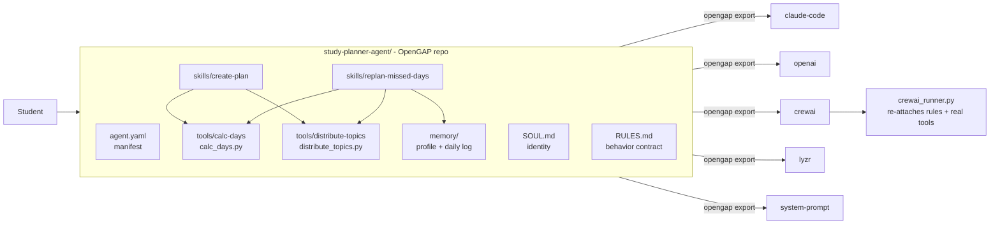

# Study Planner Agent: a portable agent with a testable behavior contract

A study planning coach defined once in the open [GitAgent / OpenGAP](https://www.lyzr.ai/opengap) format and exported to five runtimes. Give it a syllabus, an exam date and your daily hours, and it builds a day-by-day plan with revision built in. When you miss days, it re-plans without touching what you already finished.

Built for the **Agent Passport Challenge** (HiDevs x Lyzr, presented by AI House, 13 Sep to 3 Oct 2026).

## Why it travels well

The design keeps **arithmetic in code and judgment in the LLM**:

- Date math, hour limits and topic spreading live in two small, deterministic Python tools. They give the same answer on every runtime and every model.
- The LLM handles the conversation: asking for missing inputs, explaining trade-offs, and wording the plan.

This means the rules that matter most (never over-schedule a day, always reserve revision time, never reschedule finished work) are enforced by tested code, not left to the model's goodwill.

## Architecture



| Part | File | Role |
|---|---|---|
| Manifest | `agent.yaml` | Name, model (Claude Sonnet 4.5, Haiku 4.5 fallback), skills, tools |
| Identity | `SOUL.md` | Calm, specific coach. Realism over optimism |
| Behavior contract | `RULES.md` | Must always / must never / output constraints |
| Skill | `skills/create-plan/SKILL.md` | Confirm inputs, then `calc-days`, then `distribute-topics`, then report overflow |
| Skill | `skills/replan-missed-days/SKILL.md` | Read memory, keep done days, re-plan only what is left |
| Tool | `tools/calc-days.yaml` + `calc_days.py` | Days left, split into study days and revision days (20% default) |
| Tool | `tools/distribute-topics.yaml` + `distribute_topics.py` | Fill days up to the hour limit, skip completed topics, report what does not fit |
| Memory | `memory/` | Student profile and a daily progress log |

Tools use **JSON on stdin and JSON on stdout**, the same protocol the OpenGAP spec defines for hooks, so any runtime that can spawn a process can call them.

## Behavior contract

| Rule (`RULES.md`) | Enforced by | Verified in |
|---|---|---|
| Never schedule more hours than available | `distribute-topics` (code) | all 3 scenarios |
| Reserve at least 20% of days for revision | `calc-days` (code) | all 3 scenarios |
| Never invent topics outside the syllabus | `distribute-topics` only uses given topics | all 3 scenarios |
| Never overwrite completed days | `replan-missed-days` skill + `completed` input | scenario 2 |
| Say clearly when the syllabus does not fit | `fits: false` + `unscheduled` list | scenario 3 |
| Dates in YYYY-MM-DD | `calc-days` output | all 3 scenarios |
| Ask for exam date, hours, topics first | LLM via `SOUL.md` / `create-plan` | **not verified (no LLM run)** |
| No medical, mental-health or legal advice | LLM via `RULES.md` | **not verified (no LLM run)** |

## Verification evidence

| Check | Command | Result |
|---|---|---|
| Spec validation | `opengap validate -d study-planner-agent` | Passed, 0 warnings |
| Tool unit self-tests | `python study-planner-agent/tools/calc_days.py --selftest` (and `distribute_topics.py`) | ok |
| 3 end-to-end scenarios, 18 rule checks | `python scenarios.py` | 3/3 PASS ([evidence/SUMMARY.md](evidence/SUMMARY.md)) |
| CrewAI portability fix | `python crewai_runner.py --check` | ok |

Scenarios ([evidence/](evidence/)):

1. **Fresh plan**: 28 h of syllabus, 14 days, 3 h/day. Everything fits, with 3 revision days.
2. **Re-plan after 2 missed days**: done days are kept as they were, finished Algebra is not rescheduled, and half-done Calculus keeps only its remaining 5 h.
3. **Impossible schedule**: 28 h into 3 days at 2 h/day. It schedules what fits and lists the rest as "does not fit".

## Portability

Full report: [exports/PORTABILITY.md](exports/PORTABILITY.md).

| Part | claude-code | openai | crewai | crewai + runner | lyzr | system-prompt |
|---|---|---|---|---|---|---|
| Identity | yes | yes | yes | yes | yes | yes |
| Rules | yes | yes | **no** | yes | yes | yes |
| Skills | yes | yes | yes | yes | yes | yes |
| Tools | listed | stubs (`# TODO`) | **no** | **real code** | listed | listed |

What the exports showed:

- The stock **CrewAI export drops `RULES.md` and the tools**. [`crewai_runner.py`](crewai_runner.py) fixes this by re-attaching the rules and skills to the backstory and wiring the real tool functions in as CrewAI tools.
- The **OpenAI export creates tool stubs, not implementations**. Point them at `study-planner-agent/tools/*.py`.
- **No export ships the tool scripts.** Keep `tools/` next to whichever export you use.

## Quick start

Requirements: Node 20+ (opengap needs 18+, the gitagent runtime 20+), Python 3.10 to 3.13 (CrewAI 1.15 requires `<3.14`), Git.

```bash
npm install -g @open-gitagent/opengap
python -m venv .venv
.venv\Scripts\activate            # Windows; use source .venv/bin/activate elsewhere
pip install -r requirements.txt
```

Validate, test and export:

```bash
opengap validate -d study-planner-agent
python scenarios.py
python crewai_runner.py --check
opengap export -d study-planner-agent -f crewai -o exports/crewai.yaml
```

Run on CrewAI with a real model (needs `ANTHROPIC_API_KEY`; set `MODEL` for another provider):

```bash
python crewai_runner.py "Exam on 2026-10-17, 3 hours a day. Topics: Algebra 6h, Calculus 8h, Probability 5h"
```

## Repository layout

```
study-planner-agent/   OpenGAP agent (the source of truth)
  agent.yaml SOUL.md RULES.md
  skills/  tools/  memory/
exports/               opengap export output for 5 targets + PORTABILITY.md
evidence/              scenario reports produced by scenarios.py
scenarios.py           runs the tools on 3 scenarios and checks RULES.md
crewai_runner.py       CrewAI runner that restores rules + real tools
```

## Limitations and what was not tested

- **No live LLM run.** No API key was available during the build. The LLM-side rules (asking for inputs, refusing out-of-scope advice, wording) are defined but not verified. Neither is behavior equivalence across runtimes.
- Only the CrewAI export was loaded into its framework. The others were checked as text. The Lyzr export was not pushed to Lyzr Studio.
- Topic hours are planned in syllabus order. There is no priority or difficulty weighting yet.
- Spaced repetition is approximated by a revision block at the end, not interleaved reviews.
- The memory layout is defined, but reading and writing it depends on the runtime. It is not exercised in the scenario tests.

## Third-party components

| Component | License | Use |
|---|---|---|
| [@open-gitagent/opengap](https://www.npmjs.com/package/@open-gitagent/opengap) 0.5.0 | MIT | Spec, validation, export |
| [@open-gitagent/gitagent](https://www.npmjs.com/package/@open-gitagent/gitagent) 2.2.0 | MIT | Runtime (optional) |
| [CrewAI](https://github.com/crewAIInc/crewAI) 1.15.23 (+ `anthropic` 0.73.0 provider) | MIT | Alternate runtime |
| [PyYAML](https://pyyaml.org/) 6.0.3 | MIT | Reading the CrewAI export |

The agent definition, tools, skills, scenario runner and CrewAI runner are original work.

## License

MIT, see [LICENSE](LICENSE).
